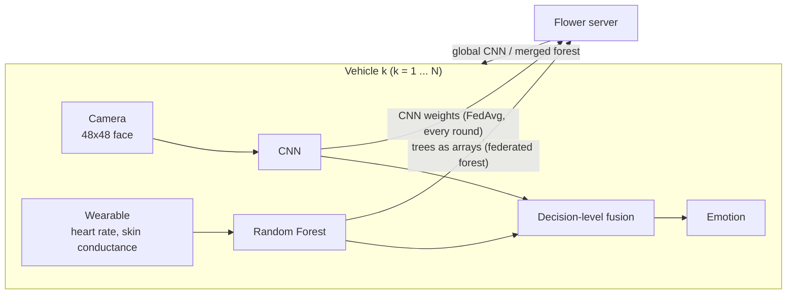
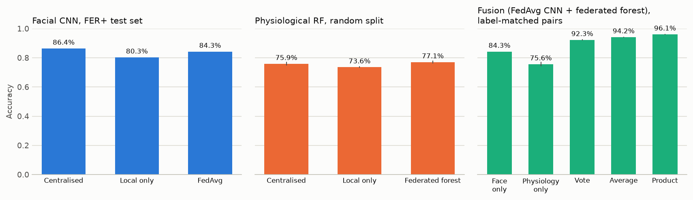
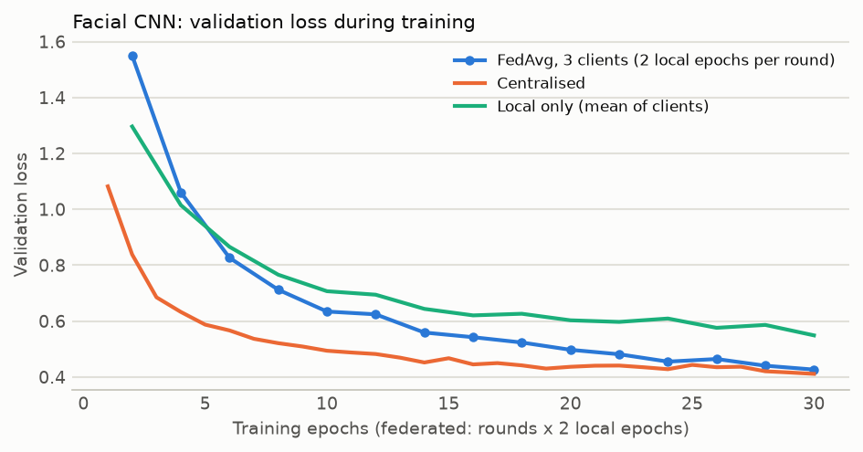

# FedMultiEmo: Multimodal Emotion Recognition with Federated Learning

Code for the paper

> B. C. Gül, S. Nadig, S. Tziampazis, N. Jazdi and M. Weyrich, "FedMultiEmo: Real-Time Emotion Recognition via Multimodal Federated Learning," *2025 5th International Conference on Electrical, Computer, Communications and Mechatronics Engineering (ICECCME)*, 2025. [doi:10.1109/ICECCME64568.2025.11277502](https://doi.org/10.1109/ICECCME64568.2025.11277502) · [arXiv:2507.15470](https://arxiv.org/abs/2507.15470)

FedMultiEmo recognises seven emotions (angry, disgust, fear, happy, sad, surprise,
neutral) in a vehicle from two modalities: facial expressions, classified by a CNN,
and physiological signals (heart rate, skin conductance), classified by a Random
Forest. Both models are trained with federated learning using
[Flower](https://flower.ai), so images and physiological recordings stay on each
vehicle; the two decisions are fused at decision level.



## Contents

- [Quick start](#quick-start)
- [Data](#data)
- [Method](#method)
- [Results](#results)
- [Running with Flower (3 or more clients)](#running-with-flower-3-or-more-clients)
- [Configuration](#configuration)
- [Differences from the paper](#differences-from-the-paper)
- [Repository layout](#repository-layout)
- [Citation](#citation)

## Quick start

Python 3.11–3.13, CPU is enough (a GPU makes the CNN faster).

```bash
git clone https://github.com/<your-org>/fedmultiemo.git
cd fedmultiemo
python -m venv .venv && source .venv/bin/activate
pip install -e ".[dev]"
pytest -q                                   # about 20 s, synthetic data only

# FER2013 is not redistributable: put Kaggle's fer2013.csv into data/fer2013/, then
python scripts/get_fer_data.py              # checks the file, fetches the FER+ labels

fedmultiemo physio                          # Random Forest regimes, under a minute
fedmultiemo face --regime fedavg            # federated CNN, 3 clients
fedmultiemo experiments                     # everything incl. fusion (about 90 min on 2 CPU cores)
```

Every command writes to `results/` (or `--output DIR`): test-set probabilities,
training histories, metrics per run as JSON/CSV, the selected CNN weights
(`face__<regime>__seed<k>_weights.npz`) and `summary.md`.

A trained CNN can be tried live on a webcam:

```bash
pip install -e ".[webcam]"
python scripts/webcam_demo.py --weights results/face__fedavg__seed0_weights.npz
```

## Data

* **Facial modality:** FER2013 with the FER+ majority labels, official
  train/validation/test splits (`Training`, `PublicTest`, `PrivateTest`).
  Not included; see [`data/README.md`](data/README.md).
* **Physiological modality:** [`data/physiological/client_{1,2,3}.csv`](data/physiological),
  heart rate and skin conductance recorded in a lab study while participants watched
  emotion-eliciting clips. Read the caveats in [`data/README.md`](data/README.md)
  before drawing conclusions from them: the three files are a random split of one
  pooled table, and they carry no participant IDs or time stamps.

## Method

### Models

| Modality | Model | Details |
|---|---|---|
| Face | CNN | Conv(32)–Conv(64)–MaxPool–Dropout(0.25)–Conv(128)–MaxPool–Conv(128)–MaxPool–Dropout(0.25)–Dense(1024)–Dropout(0.5)–Dense(7), 2.3 M parameters; random horizontal flips and ±10° rotations during training; Adam (10⁻³), batch size 64 |
| Physiology | Random Forest | 200 trees, Gini criterion, inputs heart rate and skin conductance |

### Training regimes

| Regime | Face (CNN) | Physiology (RF) |
|---|---|---|
| Centralised | all training images pooled, up to 30 epochs, early stopping on validation loss | one forest on the pooled training rows |
| Local only | every client trains alone, 15 rounds × 2 epochs; mean over clients reported | one forest per client; mean over clients reported |
| Federated | FedAvg over N clients (default 3), 15 rounds × 2 local epochs, average weighted by the number of local images | federated forest: every client trains a forest, the server merges the trees and weights each client's vote by its number of samples |

FedAvg on a Random Forest is not defined (it has no gradients or weights to
average), so the physiological model is federated as an ensemble: only trees, sent
as plain arrays, leave the clients. Training images are split over the clients either
stratified (`iid`, default) or with label skew drawn from a Dirichlet distribution
(`dirichlet`). Each client also holds a share of the validation images; the round
with the lowest validation loss is kept and evaluated once on the test set.

### Decision-level fusion

No recording contains a face and a physiological sample of the same person at the
same moment. As in the original evaluation, fusion is therefore tested on
**label-matched pairs**: every facial test image is paired with a random
physiological test sample of the same emotion. Three rules are compared:

* `vote`: majority vote of the two decisions. With two modalities every disagreement
  is a tie; it goes to the more confident modality.
* `average`: mean of the two probability vectors.
* `product`: normalised product of the two probability vectors.

Because the two samples of a pair are independent by construction, their errors are
independent too, which favours fusion. The fusion numbers below show how the two
classifiers combine; they are not a measurement on real multimodal recordings.

## Results

All numbers come from `fedmultiemo experiments` (outputs in [`results/`](results),
summary in [`results/summary.md`](results/summary.md)) on a 2-core CPU, 90 minutes in
total. The CNN was trained once (seed 0) because one run takes 25–40 minutes; the
Random Forest results are mean ± s.d. over five seeds.



**Facial CNN** (FER+ test set, 2,720 images, 3 clients):

| Regime | Accuracy | Macro-F1 | Selected round / epoch |
|---|---|---|---|
| Centralised | 86.4 % | 0.703 | epoch 30 |
| FedAvg, 3 clients | 84.3 % | 0.694 | round 15 |
| Local only (mean of 3 clients) | 80.3 % | 0.631 | round 15 |

FedAvg reaches within 2.1 points of centralised training without pooling any
images and is 4 points better than training each vehicle alone. Both the centralised
and the federated model were still improving at the end of their budget (see the
validation-loss curves below), so longer training would likely add a little more.
Macro-F1 is much lower than accuracy because FER+ is imbalanced (7 disgust and 50
fear images in the test set).



**Physiological Random Forest** (union of the three clients' test splits):

| Regime | Accuracy | Macro-F1 |
|---|---|---|
| Centralised | 75.9 ± 1.3 % | 0.760 ± 0.011 |
| Federated forest | 77.1 ± 0.9 % | 0.771 ± 0.011 |
| Local only (mean of 3 clients) | 73.6 ± 0.6 % | 0.738 ± 0.005 |

These numbers use a random split of samples, the only split the released files
allow, and they reproduce the 74 % of the paper. They measure recognition of the
same people in the same recording sessions. On the full lab recordings, which carry
participant IDs and time stamps and are not released,
[`scripts/physio_subject_analysis.py`](scripts/physio_subject_analysis.py) gives
(5 seeds, 6 participants, 4,942 samples):

| Evaluation | Accuracy | Macro-F1 |
|---|---|---|
| Random 80/20 split of samples | 72.4 ± 1.6 % | 0.723 |
| Same participants, later part of each recording | 66.6 ± 0.6 % | 0.664 |
| Leave one participant out | 27.4 ± 0.2 % | 0.238 |
| Always predict the most frequent class | 21.1 % | – |

From heart rate and skin conductance alone, the forest barely beats chance for a person
it has not seen. In 58 % of the samples the skin-conductance sensor sits at its resting
value (below 23 µS), whose exact level differs from session to session.

**Decision-level fusion** on label-matched pairs (FedAvg CNN + federated forest,
5 pairings):

| Rule | Accuracy | Macro-F1 |
|---|---|---|
| Face only | 84.3 % | 0.694 |
| Physiology only | 75.6 ± 1.5 % | 0.655 ± 0.023 |
| Vote (tie goes to the more confident modality) | 92.3 ± 0.4 % | 0.825 ± 0.010 |
| Average of probabilities | 94.2 ± 0.3 % | 0.862 ± 0.013 |
| Product of probabilities | 96.1 ± 0.3 % | 0.917 ± 0.015 |

Fusion adds 8–12 points here, but only because each pair joins two independent
samples that share the label, so the two classifiers rarely err on the same pair. On
real recordings of one person, the two modalities' errors would be correlated, and the
physiological model would perform at the cross-subject level shown above for a new
driver. Treat the fusion rows as an upper bound, not as an estimate of in-vehicle
accuracy. The tables for the centralised and local-only CNN are in
[`results/summary.md`](results/summary.md).

## Running with Flower (3 or more clients)

The experiments above use in-process simulations (`src/fedmultiemo/train.py`), which
are deterministic and need no extra processes. The Flower App in
[`src/fedmultiemo/fl/`](src/fedmultiemo/fl) runs the same client code for real
deployments, for example one Raspberry Pi per vehicle, and works with any number of
clients.

### Local simulation

```bash
pip install -e ".[simulation]"
# Reuse the current environment instead of letting Flower build one per run.
# Set it before the first `flwr run`, which starts a local SuperLink in the background.
export FLWR_DISABLE_RUNTIME_DEPENDENCY_INSTALLATION=1
DATA="$PWD/data"

# Facial CNN, FedAvg, 3 clients
flwr run . --stream --federation-config "num_supernodes=3" --run-config \
  "modality='face' num-clients=3 fer-csv='$DATA/fer2013/fer2013.csv' ferplus-csv='$DATA/fer2013/fer2013new.csv' output-dir='$PWD/flower_out'"

# Physiological federated forest, 3 clients (one client file each) ...
flwr run . --stream --federation-config "num_supernodes=3" --run-config \
  "modality='physio' num-clients=3 physio-dir='$DATA/physiological'"

# ... or 5 clients (the three files are pooled and split evenly)
flwr run . --stream --federation-config "num_supernodes=5" --run-config \
  "modality='physio' num-clients=5 physio-dir='$DATA/physiological'"
```

`num-clients` must equal the number of SuperNodes. For the CNN, any number of
clients works (the training images are re-partitioned with `federated.partition`).
The run-config keys are listed in `[tool.flwr.app.config]` of
[`pyproject.toml`](pyproject.toml). Every round logs the clients' validation and test
metrics; with `output-dir` the final global model and the metric history are saved.
Unlike `fedmultiemo face`, the Flower app keeps the last round rather than the round
with the lowest validation loss. For the same seed the Flower federated forest and
the simulation give identical test accuracy (75.69 % for seed 0, 3 clients).

### Deployment, one SuperNode per vehicle

Install the package on the server and on every vehicle computer, copy the data each
vehicle needs to the same absolute path, then:

```bash
# Server
flower-superlink --insecure --host 0.0.0.0

# Vehicle k (k = 0 ... N-1)
flower-supernode --insecure --superlink <server-ip>:8000 --node-config "partition-id=k num-partitions=N"
```

Register the SuperLink in `~/.flwr/config.toml` on your workstation and start a run:

```toml
[superlink.vehicles]
address = "<server-ip>:8000"
insecure = true
```

```bash
flwr run . vehicles --stream --run-config "modality='face' num-clients=3 fer-csv='/data/fer2013.csv' ferplus-csv='/data/fer2013new.csv'"
```

`--insecure` disables TLS and node authentication; use it only in a closed test
network (see the [Flower documentation](https://flower.ai/docs/framework/)).

## Configuration

All settings live in [`src/fedmultiemo/default.yaml`](src/fedmultiemo/default.yaml).
Every command accepts `--config my.yaml` and repeated `--set key.subkey=value`:

```bash
fedmultiemo face --regime fedavg --config configs/five_clients.yaml          # 5 clients
fedmultiemo face --regime fedavg --config configs/non_iid.yaml               # label-skewed clients
fedmultiemo experiments --config configs/fer2013_labels.yaml                 # original FER2013 labels
fedmultiemo face --regime fedavg --set federated.rounds=30 --set federated.local_epochs=4
fedmultiemo experiments --set fer.subsample=0.05 --set federated.rounds=2    # quick smoke run
```

| Key | Default | Meaning |
|---|---|---|
| `fer.labels` | `ferplus` | `ferplus` (majority of the FER+ votes) or `fer2013` |
| `federated.num_clients` | `3` | number of clients (vehicles) |
| `federated.partition` | `iid` | `iid` or `dirichlet` (with `dirichlet_alpha`) |
| `federated.rounds`, `federated.local_epochs` | 15, 2 | FedAvg schedule |
| `cnn.learning_rate`, `cnn.batch_size`, `cnn.augment` | 0.001, 64, true | CNN training |
| `physio.client_files` | 3 CSVs | one physiological file per client |
| `physio.n_estimators` | 200 | trees per forest |
| `fusion.rules`, `fusion.visual_weight` | all, 0.5 | fusion rules and weight of the facial model |

## Differences from the paper

This repository is a cleaned-up version of the original client/server scripts.
Where it deviates from the paper or from those scripts, it does so for the reasons
below.

| Aspect | Paper / original code | This repository |
|---|---|---|
| CNN | three conv blocks (paper); four conv layers (code) | the code's four-layer CNN, unchanged |
| CNN optimiser | Adam, learning rate 10⁻⁴ | Adam 10⁻³: after four epochs the validation loss was 0.63 vs 1.00 with 10⁻⁴ |
| CNN schedule | 4 local epochs (paper), 2 (code); 18–20 rounds | 15 rounds × 2 local epochs; the round with the lowest validation loss is kept |
| Physiological features | HRV, maximum EDA and temperature fluctuation over 5-s windows | heart rate and skin conductance per sample, as in the original code; the released files have no time stamps and no skin temperature |
| Random Forest | 200 trees (paper), 100 (code) | 200 trees |
| Federated RF | FedAvg-style update (Eq. 11) | federated forest: union of the client forests, weighted by sample counts |
| Fusion | majority vote of two modalities | vote with an explicit tie rule, plus probability averaging and product |
| Encryption | CKKS encryption module imported by the clients | not included (not part of the paper) |
| Evaluation | single run, splits not reported | official FER2013 splits, client-local validation shares, 5 seeds for the RF, test set used once |

## Repository layout

```
fedmultiemo/
├── configs/                  example configurations (5 clients, non-IID, FER2013 labels)
├── data/
│   ├── README.md             data sources, columns and caveats
│   └── physiological/        client_1.csv ... client_3.csv
├── src/fedmultiemo/
│   ├── default.yaml          all settings
│   ├── data.py               FER/FER+ loading, client partitions, physiological files
│   ├── models.py             CNN, Random Forest, federated forest, forests as arrays
│   ├── train.py              centralised, local and federated training; metrics
│   ├── fusion.py             label-matched pairing and fusion rules
│   ├── cli.py                `fedmultiemo face | physio | fusion | experiments`
│   └── fl/                   Flower ServerApp and ClientApp
├── scripts/
│   ├── get_fer_data.py       FER2013 checksum, FER+ label download
│   ├── physio_subject_analysis.py   subject-aware RF evaluation on the full lab table
│   ├── make_figures.py       figures for this README
│   └── webcam_demo.py        real-time demo with a trained CNN
├── results/                  outputs of the runs reported above
└── tests/
```

## Citation

```bibtex
@inproceedings{guel2025fedmultiemo,
  author    = {G{\"u}l, Baran Can and Nadig, Suraksha and Tziampazis, Stefanos and Jazdi, Nasser and Weyrich, Michael},
  title     = {FedMultiEmo: Real-Time Emotion Recognition via Multimodal Federated Learning},
  booktitle = {2025 5th International Conference on Electrical, Computer, Communications and Mechatronics Engineering (ICECCME)},
  year      = {2025},
  pages     = {1--8},
  doi       = {10.1109/ICECCME64568.2025.11277502}
}
```

## Licence and acknowledgements

The code is released under the [MIT licence](LICENSE). The physiological recordings
in `data/physiological/` are released under
[CC BY 4.0](https://creativecommons.org/licenses/by/4.0/). FER2013 and the FER+
labels keep their own terms and are not part of this repository.
